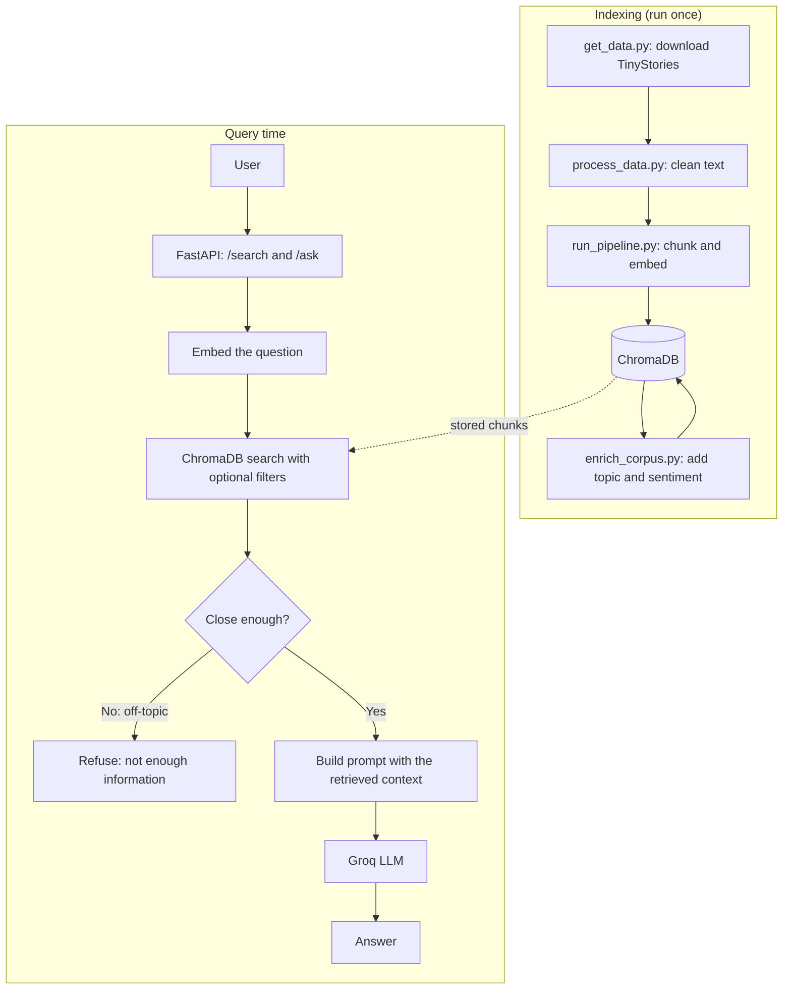

# Parallax Labs: Retrieval-Augmented Generation (RAG) System

A complete RAG system over 5,000 short children's stories (the TinyStories dataset). It cleans the text, splits it into chunks, stores embeddings in ChromaDB, labels every chunk with a topic and a sentiment, and answers questions with an LLM that may only use the retrieved text. Everything is available through a FastAPI service, with automated retrieval and end-to-end evaluations.

Built for the Parallax Labs ML engineering internship (Weeks 1 to 6).

## Results at a glance

| Area | Result |
|---|---|
| Corpus | 5,000 stories, 11,161 chunks (500 characters, 50 overlap) |
| Retrieval | Precision@1 = 0.74, Recall@3 = 0.60, average search time 17.7 ms |
| Answer quality | 12/19 correct (63%); 11/13 (85%) when the right chunk was retrieved |
| Hallucination guard | 3/3 off-topic questions refused |
| End-to-end latency | 0.81 s average, 1.48 s slowest |V
| Sentiment (VADER) | 85% agreement with my manual labels (17/20) |
| Tests | 29 passing |

Details and limits of each number are in [Evaluation results](#evaluation-results).

## Architecture



**How a question is answered (`POST /ask`):**
1. The question is embedded with `all-MiniLM-L6-v2`.
2. ChromaDB returns the 3 closest chunks.
3. **Guard 1 (retrieval):** if even the closest chunk is too far away (distance above 1.3), the LLM is never called and the system refuses.
4. **Guard 2 (prompt):** otherwise the LLM gets the chunks and a system prompt that allows only the given context and gives an exact refusal sentence.
5. The answer is returned with the retrieved chunks and a timing breakdown.

## Project structure

```
.
├── get_data.py              # Download 5,000 stories -> data/raw/
├── process_data.py          # Clean them -> data/processed/clean_corpus.jsonl
├── run_pipeline.py          # Chunk, embed, and store in ChromaDB
├── requirements.txt
├── src/
│   ├── preprocessing.py     # HTML stripping, Unicode normalization, whitespace cleanup
│   ├── chunking.py          # Recursive text chunking
│   ├── embeddings.py        # sentence-transformers embeddings + timing
│   ├── vector_store.py      # ChromaDB setup and ingestion
│   ├── llm_client.py        # Groq API client with retries
│   ├── prompt_template.py   # System prompt and context injection
│   ├── rag_pipeline.py      # Retrieval + out-of-domain check + generation
│   ├── nlp_analysis.py      # LDA topics and VADER sentiment
│   └── api.py               # FastAPI service
├── scripts/
│   ├── verify_env.py        # Environment check (Week 1)
│   ├── test_retrieval.py    # Quick retrieval latency check
│   ├── test_rag.py          # Sample questions through the full pipeline
│   ├── enrich_corpus.py     # Add topic + sentiment metadata to ChromaDB
│   ├── make_label_set.py    # Label 20 chunks by hand (interactive)
│   ├── evaluate_sentiment.py
│   ├── test_filtered_retrieval.py
│   ├── make_testset.py      # LLM writes test questions -> evaluation/testset.json
│   ├── evaluate_retrieval.py    # Precision@K and Recall@K
│   └── evaluate_end_to_end.py   # Answer quality and latency
├── tests/                   # 29 pytest tests
├── evaluation/              # Test set, manual labels, and all evaluation reports
└── data/                    # raw/, processed/ and chroma_db/ (git-ignored, rebuilt by the steps below)
```

## Setup

Developed on Windows with Python 3.12. On Mac/Linux, use `source venv/bin/activate` instead of the activate line below.

```bash
git clone https://github.com/HabibaBasathia/parallax-labs-week1.git
cd parallax-labs-week1
python -m venv venv
venv\Scripts\activate
pip install -r requirements.txt
```

Create a file named `.env` in the project root with a free Groq API key (get one at https://console.groq.com, no card needed):

```
GROQ_API_KEY=your_key_here
```

The `.env` file is git-ignored, so the key is never pushed.

## Running the system

**1. Build the data (once).** The `data/` folder is git-ignored, so a fresh clone must run these:

```bash
python get_data.py                  # download the stories
python process_data.py              # clean them
python run_pipeline.py              # chunk, embed, store (11,161 chunks)
python -m scripts.enrich_corpus     # add topic + sentiment labels
```

**2. Start the API:**

```bash
python -m uvicorn src.api:app --reload
```

Wait for `Application startup complete` (the embedding model loads first), then open http://127.0.0.1:8000/docs to try every endpoint in the browser.

**3. Run the evaluations** (stop the API first, so two programs do not use the database at once):

```bash
python -m scripts.evaluate_sentiment      # VADER vs my manual labels
python -m scripts.evaluate_retrieval      # Precision@K, Recall@K
python -m scripts.evaluate_end_to_end     # answer quality + latency (about 5 minutes)
python -m scripts.test_filtered_retrieval # filtered search + latency
```

**4. Run the tests:**

```bash
python -m pytest tests/
```

Expected: `29 passed`.

**Reproducibility notes:**
- The test set (`evaluation/testset.json`) and my manual labels (`evaluation/manual_labels.csv`) are committed, so the evaluation scripts above reproduce my numbers without regenerating them.
- `make_label_set.py` and `make_testset.py` **overwrite** those files. `make_testset.py` uses an LLM, so it writes different questions each time and the numbers will change slightly.
- Random seeds are fixed (LDA topics: 42, label sample: 7, test set sample: 11). LLM answers are not fully deterministic.
- Free API limits apply. The end-to-end script pauses 5 seconds between questions, and the LLM client retries up to 3 times on rate limits.

## API usage and example queries

| Endpoint | Purpose |
|---|---|
| `GET /health` | Check that the service is running |
| `POST /search` | Semantic search; optional `top_k`, `sentiment`, `topic` filters |
| `POST /ask` | Full RAG: retrieve, then generate an answer |

**Ask a question** (PowerShell; on Mac/Linux use `curl -X POST ... -H "Content-Type: application/json" -d '...'`):

```powershell
Invoke-RestMethod -Uri http://127.0.0.1:8000/ask -Method Post -ContentType "application/json" -Body '{"question": "What lesson does the little boy learn?"}'
```

Response (abbreviated; timings are in seconds):

```
{
  "answer": "He learns that when something seems too hard, taking a break and coming back to it later can make it suddenly easier.",
  "retrieved_chunks": ["Once there was a little boy and he wanted to learn. He went to the chest every day ...", "..."],
  "out_of_domain": false,
  "retrieval_time_s": <seconds>,
  "generation_time_s": <seconds>,
  "total_time_s": <seconds>
}
```

**An off-topic question** (`{"question": "What is the capital of France?"}`) is refused without calling the LLM. The answer is `"I don't have enough information in the provided context to answer this question."` and `out_of_domain` is `true`.

**Search with filters** (only negative chunks, from one topic):

```json
{"query": "a child is sad and cries", "top_k": 3, "sentiment": "negative", "topic": "bird_happy_day"}
```

The response has `count`, `latency_s`, and `results`, where each result has `id`, `text`, `distance` (lower is closer), `topic` and `sentiment`.

**Errors:**

| Status | When | Example |
|---|---|---|
| 400 | Valid type, unacceptable value | Blank query, or sentiment other than positive/negative/neutral |
| 422 | Wrong or missing fields | `{"query": "dog", "top_k": "abc"}` |
| 500 | Internal failure | Database error, or the LLM call failed |

Every request is logged as one line: method, path, status code and duration.

## Design decisions

- **Chunking:** recursive splitting (paragraph, then sentence, then word) at 500 characters with 50 overlap, so ideas stay together and context is not lost at boundaries.
- **Embeddings:** `all-MiniLM-L6-v2`. It is small, fast and runs locally. Embedding takes about 20 to 25 ms per chunk.
- **Vector database:** ChromaDB, saved on disk. Chunks are written with `upsert`, so re-running the pipeline creates no duplicates.
- **LLM:** Groq free tier, `openai/gpt-oss-20b`, temperature 0.2 and at most 512 output tokens. The originally planned `llama-3.1-8b-instant` was retired by Groq during development. The client's error handling surfaced the 404 clearly, and I switched models.
- **Top-K = 3:** Recall stops improving between K=3 and K=5 (0.60 to 0.61), so more chunks only add noise.
- **Topics (LDA) and sentiment (VADER):** BERTopic often fails to install on Windows and needs heavy models. LDA is simple and reproducible, and VADER needs no model download.
- **Distance threshold 1.3:** chosen by hand and checked on 3 off-topic questions. It was not tuned systematically.

## Evaluation results

### Retrieval (19 questions)

An LLM wrote one question for each of 19 random chunks. A chunk counts as relevant if it comes from the same story.

| K | Precision@K | Recall@K | Source chunk found |
|---|---|---|---|
| 1 | 0.74 | 0.37 | 9/19 |
| 3 | 0.40 | 0.60 | 13/19 |
| 5 | 0.25 | 0.61 | 13/19 |

Average search time (embedding + search): 17.7 ms. A story has only 2.4 relevant chunks on average, so Precision@5 cannot exceed about 0.48. Six of 19 questions did not find their source chunk in the top 5; many are general ("What did Ben find on the shelf?") and many stories share character names.

### End-to-end (19 in-domain + 3 off-topic questions)

| Metric | Result |
|---|---|
| Correct answers (refusals count as wrong) | 12/19 (63%) |
| Correct among the 15 questions actually answered | 12/15 (80%) |
| Refused ("not enough information") | 4/19 |
| Accuracy when the source chunk was retrieved | 11/13 (85%) |
| Accuracy when the source chunk was not retrieved | 1/6 (17%) |
| Off-topic questions refused | 3/3 |

**Main finding:** answer quality depends on retrieval. When search finds the right chunk, answers are mostly correct. When it misses, the system usually refuses or answers wrongly.

### Latency

| Stage | Average |
|---|---|
| Retrieval | 0.059 s |
| Generation (LLM) | 0.752 s |
| **Total** | **0.811 s** (slowest 1.479 s) |

Filtered searches (sentiment, topic, or both) took 17 to 67 ms. The first search after startup is much slower (7.8 s measured) because the embedding model and database load once. The API loads the model at startup to avoid this. I did not measure an unfiltered search after warm-up, so I cannot give an exact filtering overhead.

### NLP metadata (11,161 chunks)

**Topics (LDA, 8 topics, each named by its 3 strongest words):**

| Topic | Chunks |
|---|---|
| little_day_man | 2,076 |
| said_mom_mommy | 1,714 |
| timmy_play_day | 1,425 |
| bird_happy_day | 1,348 |
| tree_day_big | 1,329 |
| lily_ben_tom | 1,282 |
| lily_mom_said | 1,014 |
| happy_car_day | 973 |

The topics are mostly character names plus common story words. This corpus repeats the same names and words a lot, so LDA groups by characters more than by true themes.

**Sentiment:** positive 9,532, negative 1,533, neutral 96.

**Sentiment accuracy:** VADER matched my manual labels on 17 of 20 chunks (85%). Details are in `evaluation/sentiment_report.txt`. All 3 mistakes were chunks I labeled negative. A chunk is cut from the middle of a story and can sound happy on its own while the story around it is sad, and VADER only reads the words in the chunk.

## Edge cases and error handling

- **Chunking:** empty or whitespace-only text returns no chunks.
- **Ingestion:** empty chunks are skipped, and mismatched chunk/embedding counts raise a clear error.
- **Topics:** chunks under 5 words, or with only rare or unknown words, get `uncategorized`. Words seen in fewer than 5 chunks are ignored.
- **Sentiment:** empty text is `neutral`.
- **Filters:** a filter that matches nothing returns an empty result and does not crash.
- **LLM calls:** up to 3 retries (5 s apart) on rate limits and connection errors. If all fail, an `Error:` message is returned and the API answers 500.
- **Off-topic questions:** refused by the retrieval check or by the prompt.

## Limitations and future work

- **Small evaluations:** 19 test questions and 20 hand-labeled chunks. 15 of the 20 labeled chunks were positive, so an "always positive" tool would already score about 75%.
- **Test questions and grading are LLM-based:** an LLM wrote the questions and graded the answers (it sees only the source chunk). Both can be too strict or too lenient, and I did not check the grader by hand.
- **"Relevant" means the same story:** a chunk from another story could also answer a general question, so real retrieval quality is probably a bit higher than measured.
- **Refusals are not split by cause:** the evaluation does not separate refusals from the distance check and refusals from the LLM.
- **Text cleaning:** Unicode normalization keeps only ASCII, so non-English text would be damaged, and there is no language filtering.
- **Data:** the corpus is synthetic children's stories, so results may not carry over to other text.
- **API:** no authentication or rate limiting. It is meant for local use.
- **Future work:** larger chunks or story-level context, re-ranking, hybrid (keyword + vector) search, embedding all chunks in larger batches for faster ingestion, and checking the LLM grader against hand-graded answers.

## Tests

29 pytest tests: 15 for the API (success cases and the 400, 422 and 500 errors, with the database and LLM replaced by fakes), 5 for chunking, 7 for topics and sentiment, and 2 for text cleaning.